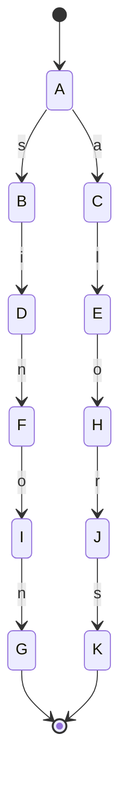
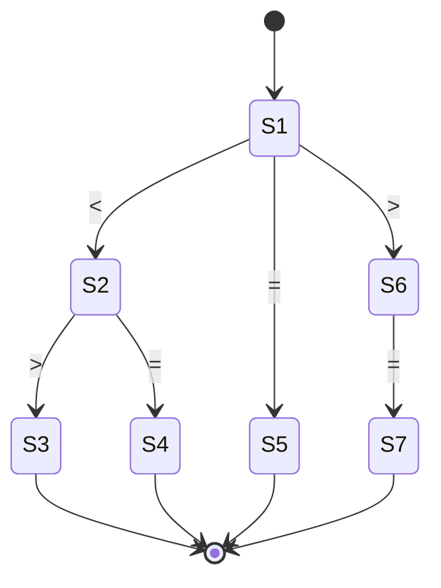
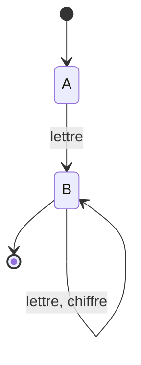
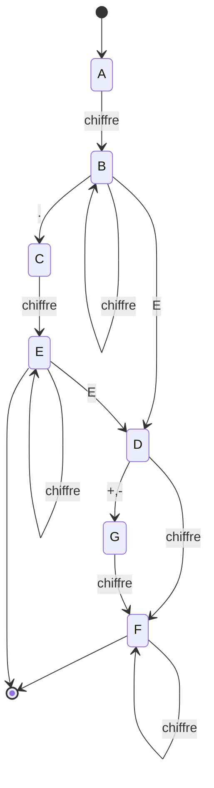

# 📘 README — TP Analyseur Lexical & AFDM

<p align="center">
  
  
  
  
</p>

<p align="center">
  <i>Construction d'un analyseur lexical par Automates Finis Déterministes Minimaux (AFDM)</i><br>
  <b>AIT YAHIA SAAD & ERRAMI YOUSSEF</b> — Encadré par <b>Mme. DOUZI</b><br>
  <sub>Année universitaire 2026-2027</sub>
</p>

---

## 📑 Sommaire

- [🎯 Objectif du TP](#-objectif-du-tp)
- [📐 Définitions Régulières](#-définitions-régulières)
- [🗂️ Structure du Projet](#️-structure-du-projet)
- [⚙️ Environnement & Compilation](#️-environnement--compilation)
- [🚀 Guide d'Utilisation](#-guide-dutilisation)
- [🧪 Jeux de Tests & Résultats](#-jeux-de-tests--résultats)
- [📊 Synthèse des AFDMs](#-synthèse-des-afdms)
- [📝 Notes Techniques](#-notes-techniques)

---

## 🎯 Objectif du TP

> **Construire un analyseur lexical isolant le lexème associé à la prochaine unité lexicale d'un tampon d'entrée.**

La démarche suivie s'articule en **trois étapes** :

```
┌─────────────────┐     ┌─────────────────┐     ┌─────────────────┐
│  1. Définitions │ ──▶ │  2. Construction│ ──▶ │  3. Implémen-   │
│     Régulières  │     │  AFN → AFD →    │     │  tation (Flex / │
│                 │     │  AFDM           │     │  C manuel)      │
└─────────────────┘     └─────────────────┘     └─────────────────┘
```

---

## 📐 Définitions Régulières

| # | Unité Lexicale | Définition Régulière | Description |
|:-:|:--------------:|:---------------------|:------------|
| 1 | `SI` | `si` | Mot-clé conditionnel |
| 2 | `ALORS` | `alors` | Mot-clé de conséquence |
| 3 | `SINON` | `sinon` | Mot-clé alternatif |
| 4 | `OPREL` | `< \| <= \| = \| <> \| > \| >=` | Opérateurs relationnels |
| 5 | `ID` | `lettre(lettre\|chiffre)*` | Identificateur |
| 6 | `NB` | `chiffre+(.chiffre+)?(E(+ \| -)?chiffre+)?` | Nombre (entier, réel, scientifique) |

---

## 🗂️ Structure du Projet

```
📦 TP_Analyseur_Lexical/
│
├── 📁 Tp_automate/                  ← 🎯 Analyseur C (automate codé à la main)
│   ├── main.c                       (Automate 23 états — implémentation manuelle)
│   ├── Lexer.c                      (Variante avec lecture bufferisée)
│   ├── input.txt                    (Entrée source)
│   ├── sortie_analyseur.txt         (Sortie tokens)
│   ├── Automate                     (Représentation de l'automate)
│   └── bin/Debug/Tp_automate_IK.exe
│
├── 📁 tp_flex/                      ← 🧪 Exercices Flex
│   ├── exo1/          → Reconnaissance identifiants [a-zA-Z][a-zA-Z0-9]*
│   ├── exo1_B_1/      → Mots-clés C + opérateurs + symboles
│   ├── exo1_B2/       → + Nombres flottants / entiers
│   ├── exo2/          → Reconnaissance de commentaires /* */ et //
│   ├── EXO3_1/        → Mots contenant a,e,i,o,u dans l'ordre
│   ├── EXO3_2/        → Mots commençant/finissant par 'a'
│   ├── exo3_c/        → Mots de type (ab)*a? | (ba)*b?
│   ├── exo3_d/        → Mots de type b*(a*(bb)*)*b*
│   └── TP3.pdf
│
├── 📁 test/                         ← 🧪 Tests unitaires Flex
│   ├── sample.l                     (Test capitales/minuscules)
│   ├── GUID.txt                     (Rappel des commandes)
│   └── program
│
└── 📄 CR_AFDMs (Réparé).docx        ← 📘 Compte-rendu théorique complet
```

---

## ⚙️ Environnement & Compilation

### Prérequis

<table>
<tr><td><b>Outil</b></td><td><b>Version minimale</b></td><td><b>Rôle</b></td></tr>
<tr><td><code>flex</code></td><td>2.6+</td><td>Génération de lex.yy.c</td></tr>
<tr><td><code>gcc</code></td><td>9.0+</td><td>Compilation C</td></tr>
<tr><td><code>libfl</code></td><td>—</td><td>Bibliothèque Flex</td></tr>
</table>

### Compilation

**🐧 Linux / macOS** — Analyseur principal (C manuel) :

```bash
cd Tp_automate
gcc main.c -o analyseur
./analyseur
```

**🔥 Avec Flex** — Compilation d'un exercice :

```bash
cd tp_flex/exo1
flex 0.l
gcc lex.yy.c -lfl -o program
./program < data.dat
```

---

## 🚀 Guide d'Utilisation

### Analyseur C (automate manuel)

```bash
./analyseur [options]
```

| Fichier | Sens |
|:--------|:-----|
| `input.txt` | 📥 Entrée (lu automatiquement) |
| `sortie_analyseur.txt` | 📤 Sortie (tokens générés) |

### Analyseur Flex

```bash
./program < data.dat
```

---

## 🧪 Jeux de Tests & Résultats

### ✅ Test global — `Tp_automate/input.txt`

<table>
<tr><th>📥 Entrée</th><th>📤 Sortie (tokens)</th></tr>
<tr><td>

```
iden lf  ok 5 ;
= >= <= < = > =
f& 2.5;
f

5*/
5 ir"'"
sisinon alorsi sialors si alors if sinon si
```

</td><td>

```
ID ID ID NB
OPREL OPREL OPREL OPREL OPREL OPREL OPREL
ID NB
ID
NB
NB ID
ID ID ID SI ALORS ID SINON SI
```

</td></tr>
</table>

### ✅ Tests Flex par exercice

| Exercice | Règle testée | Exemple d'entrée | Sortie attendue |
|:---------|:-------------|:-----------------|:----------------|
| `exo1` | Identifiants | `hello world 123` | `<hello> <world> 123` |
| `exo1_B_1` | Mots-clés C | `for i=0;` | ` Mot_Cle <i> operateur integer` |
| `exo1_B2` | Flottants | `3.14 2e10` | ` float  float ` |
| `exo2` | Commentaires | `/* test */` | `<Comment>` |
| `EXO3_1` | Voyelles ordonnées | `bacdef` | `Cinq voyelles dans l'ordre <bacdef>` |
| `EXO3_2` | a…a | `abcda` | `Mot commençant ou finissant par a<abcda>` |
| `exo3_c` | (ab)*a? | `abab` | `Mot valide <abab>` |
| `exo3_d` | b*(a*(bb)*)*b* | `bbaabb` | `Mot valide <bbaabb>` |

---

## 📊 Synthèse des AFDMs

### 1️⃣ Mots-clés (`si`, `sinon`, `alors`)

**AFDM — 11 états**



| État | Symbole | Cible | Type |
|:----:|:-------:|:-----:|:----:|
| **A** | `s` | B | — |
| **A** | `a` | C | — |
| **B** | `i` | **D** | ✅ `SI` |
| **C** | `l` | E | — |
| **E** | `o` | H | — |
| **H** | `r` | J | — |
| **J** | `s` | **K** | ✅ `ALORS` |
| **D** | `n` | F | — |
| **F** | `o` | I | — |
| **I** | `n` | **G** | ✅ `SINON` |

### 2️⃣ Opérateurs Relationnels (`OPREL`)

**AFDM — 7 états**



| Transition | Symbole | Cible | Token |
|:----------:|:-------:|:-----:|:-----:|
| 1 → 2 | `<` | 2 | — |
| 2 → 3 | `>` | 3 | `OPREL` (`<>`) |
| 2 → 4 | `=` | 4 | `OPREL` (`<=`) |
| 1 → 5 | `=` | 5 | `OPREL` (`=`) |
| 1 → 6 | `>` | 6 | `OPREL` (`>`) |
| 6 → 7 | `=` | 7 | `OPREL` (`>=`) |

> ⚠️ L'état 2 est **final** car `<` est un opérateur valide.

### 3️⃣ Identificateur (`ID`)

**AFDM minimal — 2 états**



| État | Entrée | Cible | Final |
|:----:|:------:|:-----:|:-----:|
| A | `lettre` | B | ❌ |
| B | `lettre` \| `chiffre` | B | ✅ |

### 4️⃣ Nombre (`NB`)

**AFDM — 7 états (A → G)**



| État | Rôle | Final |
|:----:|:-----|:-----:|
| A | Départ | ❌ |
| **B** | Entier (ex: `42`) | ✅ |
| C | Après point (ex: `3.`) | ❌ |
| **E** | Réel (ex: `3.14`) | ✅ |
| D | Après exposant (ex: `2E`) | ❌ |
| G | Signe (ex: `2E+`) | ❌ |
| **F** | Scientifique complet (ex: `2E+10`) | ✅ |

---

## 📝 Notes Techniques

### 🧠 Choix d'implémentation

<table>
<tr><th>Approche</th><th>Fichier</th><th>Avantages</th></tr>
<tr>
<td><b>Automate manuel</b></td>
<td><code>main.c</code></td>
<td>Contrôle total, pédagogique, pas de dépendances</td>
</tr>
<tr>
<td><b>Lexer bufferisé</b></td>
<td><code>Lexer.c</code></td>
<td>Lecture fichier complète, gestion erreurs fine</td>
</tr>
<tr>
<td><b>Flex</b></td>
<td><code>tp_flex/**/*.l</code></td>
<td>Rapide, concis, standard industriel</td>
</tr>
</table>

### 🔍 Points clés

- **Case-insensitivity** : les mots-clés sont reconnus indépendamment de la casse (`SI`, `si`, `Si`).
- **Backtracking** : utilisation de `ungetc()` pour restituer le caractère en cas de dépassement (`ID`).
- **Gestion des espaces** : `\n` incrémente `nb_ligne` pour le suivi des erreurs.
- **Nombres** : gestion intelligente des exposants incomplets (ex: `3e` retourne `3` + `e`).

### 🛠️ Commandes utiles

| Commande | Description |
|:---------|:------------|
| `flex file.l` | Génère `lex.yy.c` |
| `gcc lex.yy.c -lfl -o program` | Compile l'analyseur |
| `./program < input.txt` | Exécute sur un fichier |
| `gcc main.c -o analyseur` | Compile l'automate C manuel |
| `./analyseur` | Lance l'automate (lit `input.txt`) |

### 📋 Résumé des Tokens

<table>
<tr><th>Token</th><th>Signification</th><th>Exemples</th></tr>
<tr><td>🎯 <code>SI</code></td><td>Mot-clé conditionnel</td><td><code>si</code>, <code>SI</code></td></tr>
<tr><td>🎯 <code>SINON</code></td><td>Mot-clé alternatif</td><td><code>sinon</code></td></tr>
<tr><td>🎯 <code>ALORS</code></td><td>Mot-clé de conséquence</td><td><code>alors</code></td></tr>
<tr><td>⚖️ <code>OPREL</code></td><td>Opérateur relationnel</td><td><code><</code>, <code><=</code>, <code><></code>, <code>></code>, <code>>=</code>, <code>=</code></td></tr>
<tr><td>🔤 <code>ID</code></td><td>Identificateur</td><td><code>iden</code>, <code>f</code>, <code>x123</code></td></tr>
<tr><td>🔢 <code>NB</code></td><td>Nombre</td><td><code>5</code>, <code>2.5</code>, <code>3.14E+10</code></td></tr>
</table>

---

<p align="center">
  <sub>📚 <i>Théorie des Langages & Compilation — 2026/2027</i></sub><br>
  <sub>Réalisé avec ❤️ par <b>AIT YAHIA SAAD</b> & <b>ERRAMI YOUSSEF</b></sub><br>
  <sub>Encadré par <b>Mme. DOUZI</b></sub>
</p>
